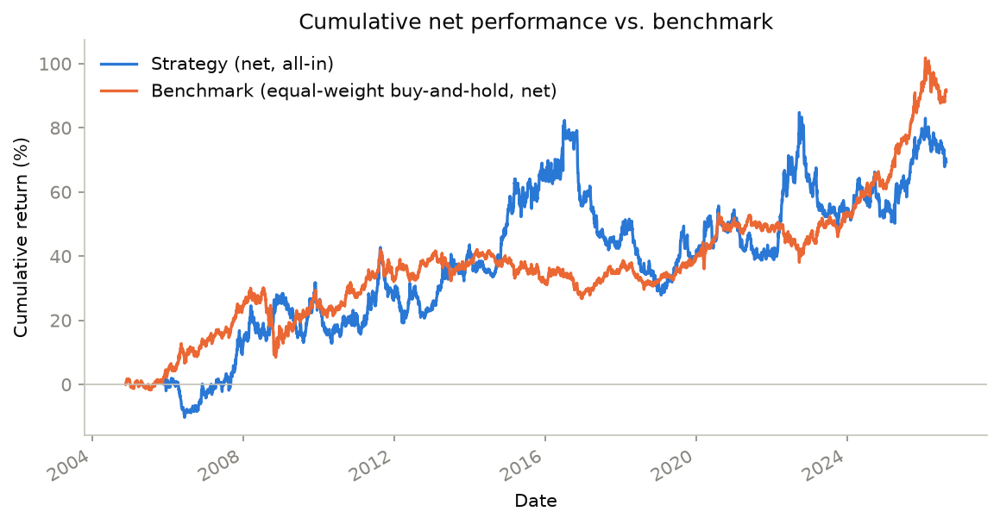

# Cross-Asset Time-Series Momentum: Gold, Treasuries and G10 FX

Does the time-series momentum effect from Moskowitz, Ooi & Pedersen (2012) survive realistic costs in a small, liquid basket I could actually trade? This project tests a 12-month TSMOM strategy on gold, US Treasuries and three G10 currency pairs, with a strict separation between the period used to design it and the period used to judge it.

**Short answer: not well enough to trade.** It worked in the 2005 to 2015 design period, but over the ten out-of-sample years (2016 to 2026) the net Sharpe ratio was about 0.03, against 0.73 for a simple equal-weight buy-and-hold basket. The verdict is **paper trade, not deploy**.



## Universe

| Leg | Instrument | Why |
|---|---|---|
| Gold | GLD (SPDR Gold Shares) | Inflation and safe-haven exposure |
| Government bonds | IEF (iShares 7-10 Year Treasury Bond ETF) | Duration and rate-cycle exposure |
| G10 FX | EUR/USD, GBP/USD, USD/JPY spot | The most heavily traded G10 currencies (BIS Triennial Survey) |

The three FX pairs all share USD as one side, so they are not fully independent. The notebook measures this directly: the mean absolute correlation among the FX legs is about 0.38, against about 0.15 between the FX legs and GLD/IEF.

## Method

- **Signal:** sign of each leg's trailing 12-month (252 trading day) return. 6 and 9-month variants are reported side by side as a robustness check, never used to pick a "best" lookback.
- **Sizing:** three deterministic steps with no optimiser. Inverse-volatility weights per leg (60-day realised vol), a portfolio-level scale to a 10% volatility target using only trailing data, then a 2x cap on gross exposure.
- **No look-ahead:** weekly rebalancing, and weights decided on day *t* are only applied to the return on day *t+1*.
- **Costs:** transaction costs per leg (7bp GLD, 3bp IEF, 2bp per FX pair, one way) plus ETF expense ratios. Borrow and financing costs are excluded but estimated separately (about 0.5% to 1.4% a year at the average exposure).
- **Design vs test split:** all rules were fixed using 2005 to 2015 and never re-fit on 2016 to 2026.
- **Benchmark:** equal-weight buy-and-hold of the same five legs, reset annually and costed the same way.

## Results (net of transaction costs and expense ratios)

| Period | Annual return | Volatility | Sharpe | Max drawdown |
|---|---|---|---|---|
| Design, 2005 to 2015 | 5.1% | 9.2% | 0.56 | -16.5% |
| **Out of sample, 2016 to 2026** | **0.2%** | **8.4%** | **0.03** | **-29.9%** |
| Benchmark, out of sample | 3.6% | 4.9% | 0.73 | -10.0% |

Robustness checks, all out of sample:
- **Lookback:** 6-month Sharpe -0.06, 9-month -0.01, 12-month 0.03. No lookback rescues it.
- **Costs:** at 0.5x the base costs, Sharpe is 0.05. At 1.5x it turns negative (-0.002), and at 2x it is -0.03. The edge is smaller than a plausible cost error.
- **Regimes:** Sharpe -0.22 in high-volatility weeks and 0.40 in low-volatility weeks. The strategy only worked when markets trended calmly.
- **Weighting:** a correlation-adjusted risk-parity variant (appendix only) reached an out-of-sample Sharpe of 0.08, still not enough to change the verdict.

## Why it underperforms the paper

The paper reports a Sharpe of about 1.0 across roughly 58 futures in four asset classes. Most of that edge comes from breadth across many weakly correlated trends. This basket has five instruments, three of which move together through the dollar, so it behaves more like three trends than five. A small basket is a fair test of whether the idea is usable at small scale, and the answer here is no.

## Data

- **GLD and IEF:** adjusted close from Yahoo Finance via `yfinance`, 2004 to present. I chose ETFs over back-adjusted continuous futures because the futures history I had stopped in 2016, and back-adjusted prices are not on a real-dollar scale (see `reports/source_note.md`).
- **FX:** this run used a vendor spot-FX history up to 2016-12-30, joined to `yfinance` from 2017 onward, with a check that the join doesn't jump by more than 3%. The vendor files are not included here. Without them, the pipeline uses `yfinance` for the full FX history, so re-running may give slightly different numbers.
- **Cleaning:** duplicates, missing values, non-positive prices and prices stale for 5 or more days are checked and logged, never filled. Legs are aligned on the dates all five traded (no forward-filling). The log is in `data/cleaned/cleaning_log.json`.

## Run it

```bash
python3.12 -m venv .venv
source .venv/bin/activate
pip install -r requirements.txt

python scripts/download_data.py      # pull prices from yfinance into data/raw/
python -m src.data_pipeline          # clean, validate, align and cache to data/cleaned/
jupyter notebook notebooks/main_analysis.ipynb
```

## Project layout

```
src/
  data_pipeline.py   load, validate, align and cache prices
  signal.py          TSMOM signal and 6/9/12-month variants
  portfolio.py       vol targeting, inverse-vol combination, 2x gross cap, risk-parity appendix
  backtest.py        weekly rebalance, one-day lag, transaction costs and expense ratios
  metrics.py         return, risk, drawdown, turnover, holding period, regime and cost-sensitivity metrics
  charts.py          matplotlib chart helpers
scripts/
  download_data.py   yfinance download (the only step that needs internet)
notebooks/
  main_analysis.ipynb   full analysis, results and verdict
reports/
  source_note.md     data sourcing decisions and caveats
  figures/           charts used in this README
```

## Reference

Moskowitz, T. J., Ooi, Y. H., & Pedersen, L. H. (2012). Time series momentum. *Journal of Financial Economics*, 104(2), 228-250.
